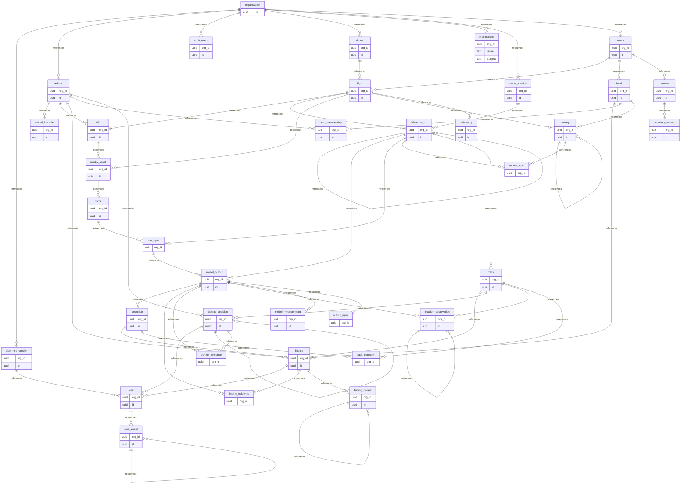

# Entity relationship diagram

Generated FK graph from migration 001. Each relationship is an actual foreign key. Multiple FK paths between the same tables are grouped. Cardinality on the child side is zero-to-many; nullable parent references and one-to-one uniqueness are detailed in the dictionary.

