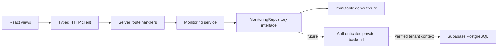

# Control layer and extension points



The browser imports `lib/cattle/client.ts` and shared contracts. It does not import repository/service code, database drivers or privileged credentials. The server establishes the current explicit demo context; client input cannot choose a real user, organization or role.

| Location | Responsibility |
|---|---|
| `lib/cattle/contracts.ts` | Typed transport/domain objects and command/receipt shapes |
| `lib/cattle/client.ts` | Fetch/error handling; the client data-transport boundary |
| `lib/cattle/map-layout.ts` | Fictional map geometry shared with the fixture |
| `app/api/overview/route.ts` | Observation snapshot endpoint |
| `app/api/alerts/[id]/review/route.ts` | Same-origin JSON request boundary, payload limits and parsing |
| `server/control/http.ts` | Composition, explicit demo identity and safe response envelopes |
| `server/control/monitoring-service.ts` | Review command validation and business outcome mapping |
| `server/repositories/monitoring-repository.ts` | Replaceable persistence port |
| `server/repositories/demo-repository.ts` | Immutable synthetic observations; no network/database access |
| `components/cattle/` | Dashboard shell, map, reusable dialogs and status presentation |

## Current API

`GET /api/overview` returns `{ data: Overview, meta: { mode: 'demo', requestId } }` with no-store caching. Transport/network failures surface an error state with retry; the UI does not silently substitute fresh fake data for a failed live response.

`POST /api/alerts/:id/review` accepts:

```json
{
  "action": "reject",
  "reason": "Occlusion prevents a useful locomotion assessment.",
  "expectedRevision": 1,
  "requestId": "a-client-generated-uuid"
}
```

Action must be acknowledge/accept/reject. The service requires an existing finding, a nonempty reason up to 2,000 characters, a positive bounded revision and a bounded request identifier. The route rejects malformed JSON, inappropriate content type, oversized input and foreign origins. Framework-level origin rejection can occur before the handler. Failure envelopes carry a stable code, user-facing message and request ID; internal exception details are not returned.

The demo service is deliberately stateless: the revision/request ID are validated for shape but do not implement concurrency control, idempotency or shared durable audit. It returns a nonpersistent receipt; the browser applies it locally. Accepting a suspected finding is review, not a veterinary diagnosis. Rejection changes alert lifecycle, not the source model output or original assessment category.

## Connecting live data later

1. Add a real authentication boundary: cryptographically verify Supabase access tokens (issuer, audience, signature, expiry), resolve tenant membership server-side, and derive actor/organization/role from that trusted result. No user/tenant claims from a request body may become authorization context.
2. Extend the repository port/service methods to require that verified tenant context. Add a live repository in the **backend**, using a restricted LOGIN assigned `cattle_backend_user`, not `postgres` or a browser-exposed service key. Never reuse the demo context for live reads or writes.
3. In each pooled transaction, assume the restricted role, set verified request claims transaction-locally, bind tenant filters, execute the existing SQL/functions and always commit/rollback before releasing the connection. Keep private evidence authorization in the control layer before streaming an object or issuing a short-lived link.
4. Map the deployed current views/review functions to the transport contracts. Add mode/version/capability distinctions explicitly; do not remove the demo label before live data is actually connected. Implement durable acknowledgement events and live expected-head compare-and-swap. On conflicting edits, reload and preserve the reviewer's intent.
5. Add durable idempotency/audit and enforce cross-request/per-user limits for live writes. The existing database migration/history work remains the schema source of truth; this UI introduces no alternative database or browser table grants.
6. Test the actual deployed LOGIN, authenticated HTTP flow, tenant isolation, signed evidence, concurrent edits and pool cleanup before enabling real operations.

The hosted preview runs on a Cloudflare Worker, which lacks raw PostgreSQL TCP connections in the Sites runtime. Host the real PostgreSQL control backend on a suitable Node/server environment, or use a separately secured HTTPS backend gateway from the Worker. Preserve the chosen frontend → control layer → private database boundary; do not expose the cattle schema through Supabase's Data API as a deployment workaround.

## Adding features

- Add numeric model metrics to a versioned observation contract and render from model/scale metadata; keep confidence separate from the value. Live feature work should replace the illustrative model labels, not assume demo scales are clinical standards.
- Add a new page by registering its `Section`/navigation entry and extracting its view component under `components/cattle`. Share the shell/dialog/status primitives.
- Add a new operation through route → service → repository. Keep business validation out of button handlers; use explicit capabilities for features not connected yet.
- Keep source event time, upload time, processing time and human review time distinct. Current locations are last-known observations, not continuous tracking.
- Promote added cattle/flight-plan browser operations to server commands only after the actual authorization and persistence implementations exist. They currently advertise local-only effects.

No Supabase credentials, database password, JWT signing key, real animal data or real precise location is included in this frontend or private demo publication.

Spotlight adds `getLatestRecording` to the repository port, `MonitoringService.latestRecording`, and `GET /api/cattle/:id/recording`. Its no-clip response is explicit; backend failures remain errors. Browser-owned favorites and optional local media are separate from the live evidence domain. See [Spotlight behavior and integration](SPOTLIGHT.md).
